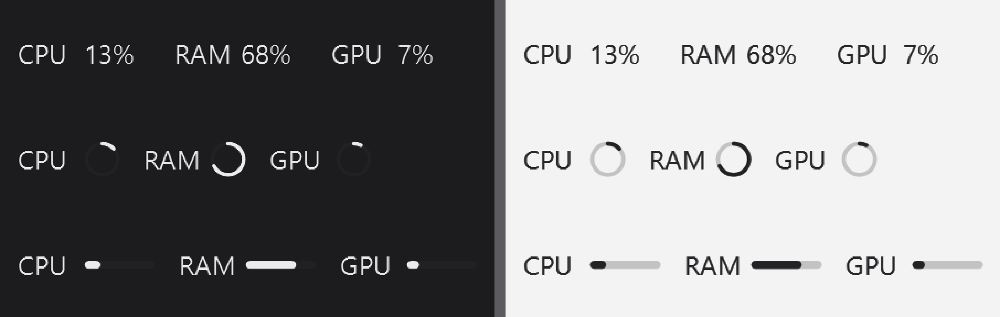

<div align="center">

# TaskbarStats

**Windows 11 任务栏 CPU / RAM / GPU 实时监视**

在任务栏最左侧常驻一行极简指标，每秒刷新。
没有图标、没有边框、没有背景色块，内容直接嵌在任务栏上。
占用率可切换三种显示样式：**数字百分比 / 环形进度条 / 长条进度条**。

[](#系统要求)
[](#系统要求)
[](#项目结构)
[](LICENSE)



<sub>自上而下：数字百分比 / 环形进度条 / 长条进度条　·　左列深色任务栏，右列浅色任务栏</sub>

</div>

---

## 目录

- [特性](#特性)
- [系统要求](#系统要求)
- [快速开始](#快速开始)
- [使用说明](#使用说明)
- [显示样式](#显示样式)
- [配置文件](#配置文件)
- [工作原理](#工作原理)
- [指标口径说明](#指标口径说明)
- [已知限制](#已知限制)
- [项目结构](#项目结构)
- [从源码构建](#从源码构建)
- [常见问题](#常见问题)
- [更新日志](#更新日志)
- [许可证](#许可证)

## 特性

| | |
|---|---|
| 🪟 **真正的透明** | 分层窗口 + `UpdateLayeredWindow` 逐像素 alpha，不是色键抠图，边缘无毛边、无黑底 |
| 📊 **三种显示样式** | 数字百分比 / 环形进度条 / 长条进度条，右键菜单随时切换，选择会被记住 |
| 🎮 **含 GPU 占用率** | 通过 Windows 自带的 PDH 性能计数器读 `GPU Engine`，跨厂商通用，不需要装驱动 SDK |
| ⚡ **几乎零开销** | 12 秒常驻实测累计消耗 **0.02 秒 CPU**（约 0.17% 单核），内存约 40MB |
| 📐 **自动跟随任务栏** | 每秒重读 `Shell_TrayWnd` 矩形；任务栏高度、位置、DPI 缩放、深浅主题变化都能跟上 |
| 🙈 **不打扰** | `WS_EX_TOOLWINDOW` + `WS_EX_NOACTIVATE`，不占任务栏按钮、不进 Alt+Tab、点击不抢焦点 |
| 🎨 **主题自适应** | 读 `SystemUsesLightTheme`，浅色任务栏自动换深色描边 |
| 📦 **零依赖** | 编译只用 Windows 自带 csc，不装 SDK；运行只要 .NET Framework 4.x（Win10/11 自带） |
| 🖱️ **可拖动** | 左键拖动调位置，位置持久化；右键菜单可开机自启、重置、退出 |

## 系统要求

- **Windows 11**（Windows 10 理论可用，未实测）
- **.NET Framework 4.x** —— Windows 10/11 预装，无需额外安装
- **不需要** .NET SDK、Visual Studio、管理员权限、显卡驱动 SDK
- GPU 监控依赖系统自带的 **PDH 性能计数器**（`GPU Engine`），Windows 10 1709+ 默认就有

## 快速开始

**方式一：直接运行**

双击 `TaskbarStats.exe`，任务栏最左边就会出现指标。

> 仓库里的 `.exe` 按 GitHub 惯例被 `.gitignore` 忽略，桌面上的 `TaskbarStats.exe` 是已编译版本。
> 自己编译见 [从源码构建](#从源码构建)。

**方式二：从源码编译**

```powershell
git clone <this-repo> TaskbarStats
cd TaskbarStats
.\build.ps1 -Run
```

## 使用说明

| 操作 | 效果 |
|---|---|
| **左键拖动** | 横向移动位置，松手后记住 |
| **右键 → 显示样式** | 切换数字 / 环形 / 长条，当前项打勾，选择写入配置 |
| **右键 → 开机自动启动** | 在启动文件夹写入 `.lnk`，不改注册表 |
| **右键 → 重置到最左侧** | 位置归零 |
| **右键 → 退出** | 结束程序 |
| **再次双击 exe** | 已运行时不会启动第二个实例（互斥锁保护） |

## 显示样式

| 样式 | 配置值 | 外观 |
|---|---|---|
| 数字百分比 | `number` | `CPU 12%  RAM 75%  GPU 10%` |
| 环形进度条 | `ring` | 细描边圆环，12 点起顺时针填充，浅色轨道表示 100% 刻度 |
| 长条进度条 | `bar` | 两端圆头的胶囊条，浅色轨道 + 实心填充 |

三种样式的窗口宽度会自动重算（以 200% 缩放为例：数字 218px / 环形 176px / 长条 224px 逻辑像素），
切换后立即生效，不需要重启。

## 配置文件

位置：`%APPDATA%\TaskbarStats\settings.ini`

```ini
offsetX=0
style=number
```

| 键 | 说明 |
|---|---|
| `offsetX` | 相对任务栏左边缘的水平偏移（物理像素），鼠标拖动时自动保存 |
| `style` | `number` / `ring` / `bar`，缺省为 `number` |

如果贴图失败，错误会记到同目录下的 `error.log`（正常使用不应出现）。

## 工作原理

整体是一个无边框的**分层窗口**，坐标实时对齐任务栏，内容用 GDI+ 画成一张 32bpp ARGB 位图后整贴上去。

```
每秒一次
   ├─ GetSystemTimes 差分          ──→ CPU 使用率
   ├─ GlobalMemoryStatusEx         ──→ RAM 使用率
   ├─ PDH: \GPU Engine(*)\Utilization Percentage ──→ GPU 使用率
   ├─ GetWindowRect(Shell_TrayWnd) ──→ 任务栏矩形 / 高度 / 位置
   ├─ 按当前样式重画 ARGB 位图
   └─ UpdateLayeredWindow ──→ 逐像素 alpha 贴到任务栏上
```

**关键点：**

| 需求 | 做法 |
|---|---|
| 没有黑框 | `UpdateLayeredWindow` + 预乘 alpha（GDI+ 输出直通 alpha，需手动预乘） |
| 文字贴在任务栏上 | 无边框顶层窗口，`SetWindowPos(HWND_TOPMOST)`，坐标对齐 `Shell_TrayWnd` |
| 不抢焦点 | `WS_EX_NOACTIVATE` + `WM_MOUSEACTIVATE` 返回 `MA_NOACTIVATE` |
| 不进 Alt+Tab | `WS_EX_TOOLWINDOW` + `ShowInTaskbar = false` |
| 数字跳动不抖动 | 数值列宽度按 `100%` 预留，标签与数值统一左对齐 |
| 环形/长条不闪 | 轨道用同色 22% 透明度，填充用实色，抗锯齿描边端点圆头 |
| GPU 一次读全部实例 | `PdhGetFormattedCounterArrayW` 通配符查询，一次收集 439 个实例约 1–4ms |
| 高 DPI 正确 | 进程声明 Per-Monitor-V2，字号按 `GetDpiForWindow` 缩放 |
| 任务栏自动隐藏 | 检测到任务栏滑出屏幕时 `Hide()` 自身 |

离线自检（不开窗口，直接导出三种样式的真实渲染结果）：

```powershell
.\TaskbarStats.exe --dump canvas
# → canvas_preview.png  三种样式 × 深/浅底色的对照图
# → canvas_alpha.png    带 alpha 通道的原始位图
# → canvas_info.txt     各样式画布尺寸、墨水覆盖率、当前读数
```

## 指标口径说明

- **CPU**：`GetSystemTimes` 两次采样的 idle / total 差值，与任务管理器口径一致。
- **RAM**：`GlobalMemoryStatusEx.dwMemoryLoad`，即物理内存占用百分比。
- **GPU**：遍历 `GPU Engine` 所有实例（每个进程 × 每个引擎一条），按引擎类型分别求和，
  再取**各引擎类型的最大值**，与任务管理器「GPU 利用率」的口径基本一致。上限截断到 100%。
  没有 GPU 或驱动未提供该计数器时显示 `--%`（图表样式下只显示灰色轨道）。

## 已知限制

1. **可能挡住最左边的按钮**
   默认贴着任务栏最左端。若任务栏在此处有「小组件 / 天气」按钮，会覆盖它并吃掉那小片区域的点击。
   → 左键把内容往右拖，或在「任务栏设置」中关闭小组件。

2. **任务栏固定在底部/顶部**
   Windows 11 不支持把任务栏拖到屏幕左右两侧（除非借助第三方工具）。代码对左右侧停靠做了兜底排布，但未实测。

3. **窗口占位是矩形**
   分层窗口的命中区域是整个矩形，不按 alpha 挖空，所以图形周围那一片点击不会穿透。

4. **GPU 读数需要一点时间**
   PDH 是速率计数器，程序启动后第 1 个 tick 才有有效差值，首次显示可能短暂为 `--%`。

## 项目结构

```
TaskbarStats/
├── .github/
│   └── workflows/
│       └── build.yml        # CI：windows-latest 上编译并自检
├── build.ps1                # 编译脚本（-Run / -Startup / -Probe）
├── src/
│   ├── TaskbarStats.cs      # 全部源码，单文件
│   └── app.manifest         # DPI 感知清单（permonitorv2），编译时内嵌
├── tools/
│   └── Probe.cs             # 开发期验证探针（窗口几何 / 抓屏差分）
├── docs/
│   ├── preview-styles.png
│   └── canvas-alpha.png
├── CHANGELOG.md
├── LICENSE
└── README.md
```

## 从源码构建

```powershell
.\build.ps1              # 编译出 TaskbarStats.exe
.\build.ps1 -Run         # 编译并立刻启动
.\build.ps1 -Startup     # 编译并设为开机自启（写 .lnk 到启动文件夹）
.\build.ps1 -Probe       # 编译后跑离线渲染自检，导出预览图
```

脚本会自动定位 `%WINDIR%\Microsoft.NET\Framework64\v4.0.30319\csc.exe`，
失败时回退到 32 位 Framework 目录。

等价的手写命令：

```powershell
C:\Windows\Microsoft.NET\Framework64\v4.0.30319\csc.exe /target:winexe /optimize+ `
  /r:System.dll /r:System.Drawing.dll /r:System.Windows.Forms.dll `
  /out:TaskbarStats.exe src\TaskbarStats.cs
```

> **注意：** Windows 自带的 csc 只支持 **C# 5**，所以源码里不能用插值字符串、`?.`、
> 表达式体成员等新语法。改动代码时请保持 C# 5 兼容。

## 常见问题

<details>
<summary><b>双击后什么都没发生？</b></summary>

几乎都是**已经有一个实例在运行**——程序用互斥锁保证单实例，第二个会静默退出。
先退出旧实例：在任务栏指标上**右键 → 退出**，或任务管理器里结束 `TaskbarStats.exe`，再启动。
</details>

<details>
<summary><b>换到另一台电脑后字体发虚？</b></summary>

透明画布上没法用 ClearType，只能灰阶抗锯齿。9pt 在 **100% 缩放**下只有 12px，
笔画会显得发灰 —— 这是物理限制。

v1.2.0 起已经改成「ClearType 遮罩转 alpha」：先用 ClearType 在不透明黑底上渲染拿到
次像素定位和 hinting，再把亮度当作 alpha 用真正的颜色合成，小字号明显变实。
同时内嵌 `app.manifest` 声明 DPI 感知，避免被系统拉伸放大。

如果仍然发虚，先在新机器上跑诊断，把输出发我：

```powershell
TaskbarStats.exe --info diag
notepad diag_diag.txt
```

重点看两行：

- `dpi awareness = Unaware` ⇒ 被系统拉伸了，说明清单没生效（检查是否用的旧 exe）
- `dpi (window) = 96` **且** 实际系统缩放不是 100% ⇒ 同上

对比不同缩放下的渲染效果：

```powershell
TaskbarStats.exe --dump shot 96     # 模拟 100%
TaskbarStats.exe --dump shot 144    # 模拟 150%
```
</details>

<details>
<summary><b>GPU 一直显示 <code>--%</code>？</b></summary>

说明系统没有提供 `GPU Engine` 性能计数器。可以这样确认：

```powershell
Get-Counter -ListSet "GPU Engine" | Select-Object -ExpandProperty Counter
```

列表为空通常是显卡驱动过旧或虚拟机的虚拟显示适配器不支持，此时 CPU / RAM 仍然正常。
</details>

<details>
<summary><b>任务栏上看不到文字？</b></summary>

1. 确认进程在跑：`Get-Process TaskbarStats`
2. 看 `%APPDATA%\TaskbarStats\error.log` 有没有 `UpdateLayeredWindow failed`
3. 如果开着任务栏自动隐藏，任务栏收起来时浮窗也会跟着收起，这是预期行为
</details>

<details>
<summary><b>能改成显示磁盘 / 网络吗？</b></summary>

可以。三处改动：
1. `Labels` 数组加一项，`MetricCount` 改成新数量；
2. `Sample()` 里填 `values[i]` / `valid[i]`；
3. 三处 `for (int i = 0; i < MetricCount; i++)` 的循环会自动适配，宽度由 `RebuildLayout()` 统一计算。
</details>

## 更新日志

见 [CHANGELOG.md](CHANGELOG.md)。

## 许可证

[MIT](LICENSE)
